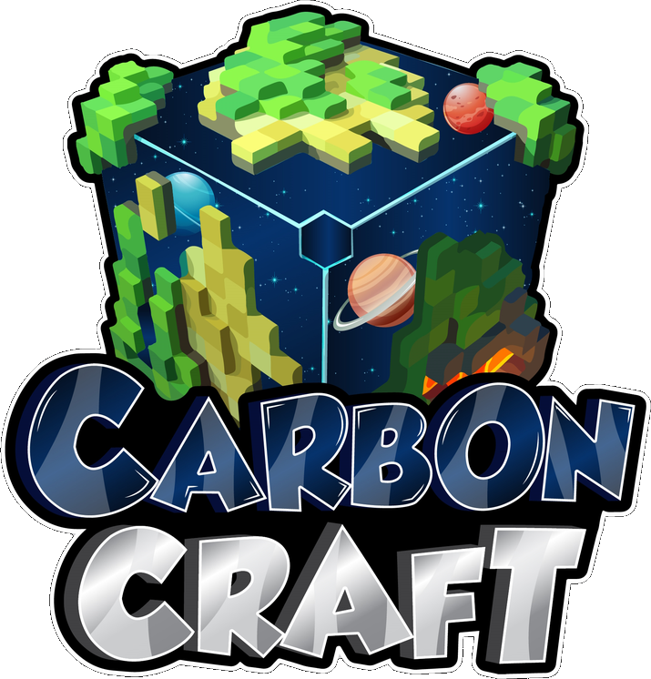

# CarbonCraft Wiki

{ .hero-logo }

Welcome to CarbonCraft, a hard-difficulty survival server with a player-run economy,
custom enchants, crates, quests and the occasional CarbonCorp™ directive.

**Server address:** `play.carboncraft.xyz` (Java and Bedrock)
{ .server-address }

## Getting started

New here? Read these in order.

1. [Joining the server](getting-started/joining.md): Java and Bedrock connection details
2. [Your first hour](getting-started/first-steps.md): from spawn to a safe, claimed base
3. [Claiming land](getting-started/claiming-land.md): protecting your builds
4. [Money & currencies](getting-started/money.md): dollars, CarbonCoins, vote points and keys
5. [Voting & vote tiers](getting-started/voting.md): the free rank ladder
6. [Commands](getting-started/commands.md): everything you can type, in one list
7. [Rules](getting-started/rules.md)

In game, `/help` opens a menu with every feature on the server.

## Mining & fishing

- [Mining](activities/mining.md): levels, Carbon, gemstones, artifacts, Vessels and Oracle bosses
- [Fishing](activities/fishing.md): 157 custom fish, augments, deliveries, totems and tournaments

## Skills

Nine [skills](skills/index.md), from Mining to Alchemy, level up as you play and give
you permanent stats and effects. Type `/skills` to see yours.

## The Syndicate

Four factions, one planet. [Earn standing](syndicates/index.md) with CarbonCorp™, the
ISD, the Union and Vivec's Rebels to unlock gear you can't get anywhere else.

## Cosmetics

- [Tags](cosmetics/tags.md): coloured chat tags, bought in packs or earned
- [Plushies](cosmetics/plushies.md): 111 mob plushies plus staff and Halloween packs

## Elsewhere

- Discord: [discord.gg/carboncraft](https://discord.gg/carboncraft) (support, announcements, giveaways)
- Store: [store.carboncraft.xyz](https://store.carboncraft.xyz)
- Instagram: [@carboncraftxyz](https://www.instagram.com/carboncraftxyz/)
- Website: [ocgames.xyz](https://ocgames.xyz)

All of these are also on the [Links](links.md) page.
