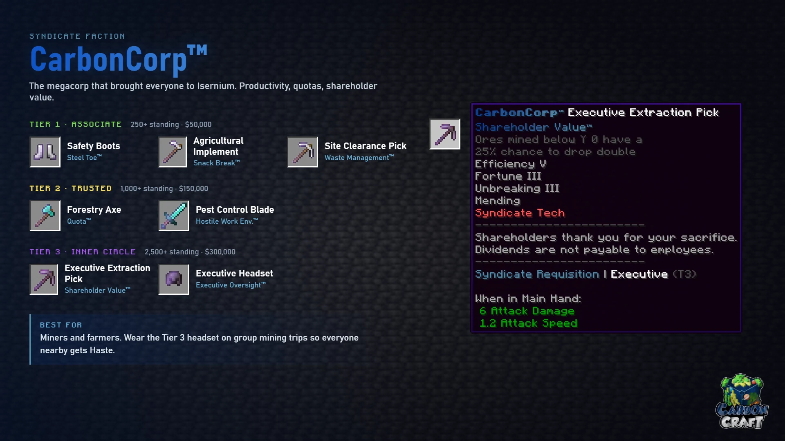

<!-- Sources (live): DeluxeMenus syndicate/carboncorp/shop.yml (perk text), detail.yml;
     EcoItems items/CarbonCorp Set (base items); CarbonContribute shop-items.yml.
     Checked 2026-10-24. -->

# CarbonCorp™

*The megacorporation that brought everyone to Isernium. Productivity, quotas,
shareholder value.*

**Best for:** miners and farmers. Wear the Tier 3 headset on group mining trips so
everyone nearby gets Haste.

| Tier | Item | Base | Perk | What it does |
|---|---|---|---|---|
| 1 | Safety Boots | Iron boots | Steel Toe™ | Immune to damage from magma blocks, campfires, cactus and berry bushes |
| 1 | Agricultural Implement | Iron hoe | Snack Break™ | Harvesting fully grown crops has a 10% chance to restore hunger |
| 1 | Site Clearance Pick | Iron pickaxe | Waste Management™ | Natural cobblestone, deepslate, netherrack, tuff, andesite, diorite and granite are shredded instead of dropped |
| 2 | Forestry Axe | Diamond axe | Quota™ | Chop 128 logs to meet quota: Haste II and Speed I for 60 seconds, plus an XP bonus |
| 2 | Pest Control Blade | Diamond sword | Hostile Work Environment™ | Killing a hostile mob grants Haste I for 15 seconds |
| 3 | Executive Extraction Pick | Netherite pickaxe | Shareholder Value™ | Ores mined below Y 0 have a 25% chance to drop double |
| 3 | Executive Headset | Netherite helmet | Executive Oversight™ | Other players within 8 blocks of you gain Haste I |

Tiers, prices and the 30-day limit work the same in every faction shop; see
[The Syndicate](index.md#3-spend-it-in-the-faction-shop).
