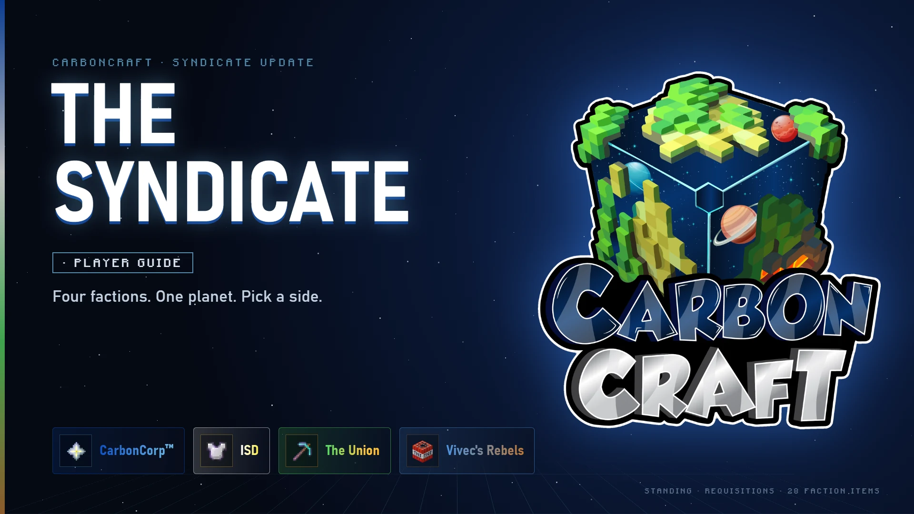
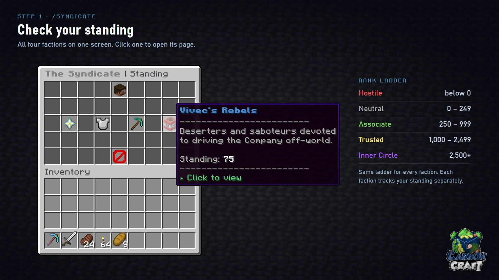
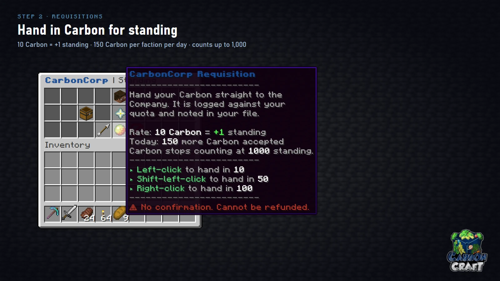
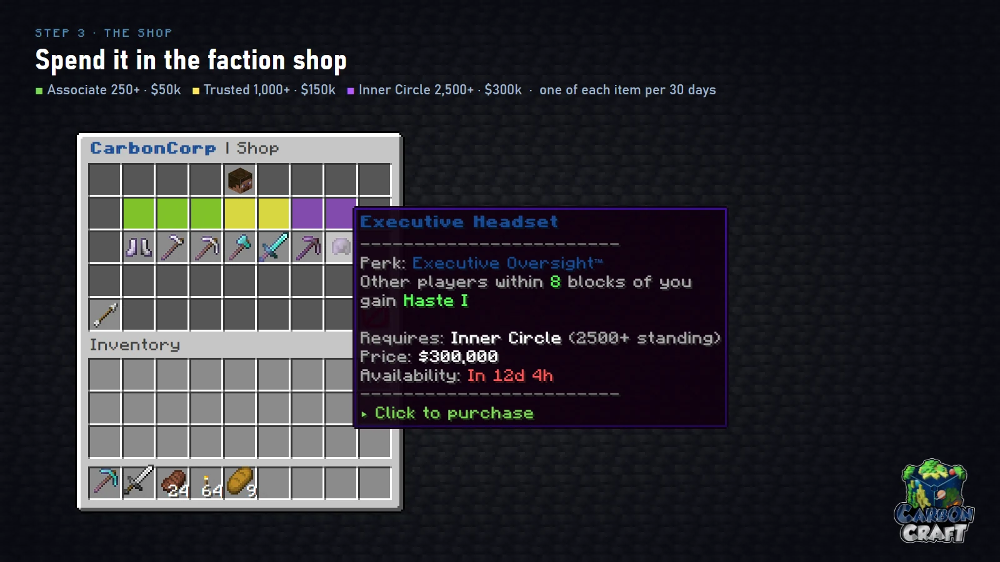
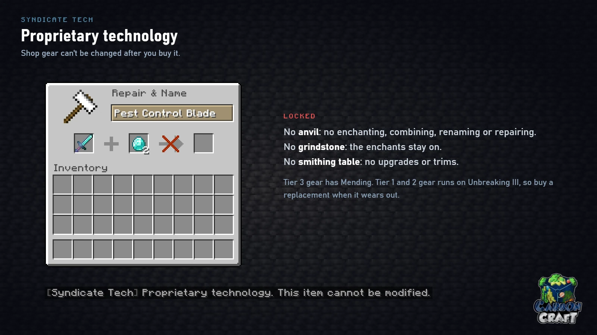

<!-- Sources (live): DeluxeMenus gui_menus/syndicate/standing.yml (open commands, blurbs),
     syndicate/<faction>/detail.yml (rank ladder, requisition buttons), lore.yml (28 entries,
     one per 100 standing, 2 written per faction); CarbonContribute config.yml (requisitions:
     10 per rep, daily cap 15, ceiling 1000) and shop-items.yml (all 28 items: 250/$50k/+10,
     1000/$150k/+20, 2500/$300k/+40); megaproject_rewards.yml (+20 CarbonCorp, +5 others);
     EcoAnvilFix config.yml (locked-enchants: syndicate_tech). Images: wiki-images/syndicates
     (recreations built 2026-10-08, matched against live 2026-10-24). -->

# The Syndicate

Four factions are fighting over Isernium, the planet CarbonCraft takes place on. Each
one tracks your **standing** separately. Raise it, and that faction opens its shop of
gear you can't get anywhere else.

| Faction | Who they are | Their gear is for |
|---|---|---|
| [CarbonCorp™](carboncorp.md) | The megacorporation that brought everyone to Isernium | Mining and farming |
| [ISD](isd.md) | Isernium Sentinel Division: law, order and oversight | Combat |
| [The Union](union.md) | The workers. Reform, not revolution. For now. | Playing in a group |
| [Vivec's Rebels](rebels.md) | Deserters and saboteurs selling jailbroken tech | Solo risk-takers |

You don't have to pick only one. Standing with one faction never lowers your standing
with another, so you can work your way up with all four.

## 1. Check your standing

Type `/syndicate` (or `/standing`) to see your standing with every faction on one
screen. Click a faction to open its page, where you'll find its shop, its lore archive
and its requisition desk.

| Rank | Standing |
|---|---|
| Hostile | below 0 |
| Neutral | 0 – 249 |
| **Associate** | 250 – 999 |
| **Trusted** | 1,000 – 2,499 |
| **Inner Circle** | 2,500+ |

Everyone starts at 0 (Neutral) with all four factions.

## 2. Earn standing

### Requisitions: hand in Carbon

On a faction's page, click the requisition button to hand Carbon straight to that
faction. **Carbon** turns up while you mine ore in the Overworld.

| | |
|---|---|
| Rate | 10 Carbon = +1 standing |
| Daily limit | 150 Carbon (+15 standing) per faction |
| Ceiling | Carbon stops counting once you reach 1,000 standing with that faction |
| Left-click / Shift-left-click / Right-click | hand in 10 / 50 / 100 |

!!! warning "There is no confirmation"
    Carbon is taken the moment you click and can't be refunded. If a click would go
    over the daily limit or the ceiling, nothing is taken.

The daily limit is per faction, so you can hand in 150 Carbon to each of the four
every day.

### Buying from the faction shop

Every shop purchase raises your standing with that faction: **+10** for an Associate
item, **+20** for Trusted and **+40** for Inner Circle. Past 1,000 standing, the
shop is how you keep climbing.

### Server projects

Some server-wide events pay standing too. Qualifying for the rewards of the Planetary
Refinery megaproject (`/megaproject`) gives +20 CarbonCorp and +5 with each of the
other three.

## 3. Spend it in the faction shop

Each faction sells seven pieces of gear across three tiers. Your standing decides which
tier you can buy from.

| Tier | Standing needed | Price | Standing gained |
|---|---|---|---|
| 1 · Associate | 250+ | $50,000 | +10 |
| 2 · Trusted | 1,000+ | $150,000 | +20 |
| 3 · Inner Circle | 2,500+ | $300,000 | +40 |

- You can buy **each item once every 30 days**. The item's tooltip shows when you can
  buy it again.
- Tier 1 gear is iron, Tier 2 is diamond, and Tier 3 is netherite.
- Every item carries one faction **perk**, a custom enchant you can't get any other way.

## Syndicate Tech

Every shop item carries **Syndicate Tech**: the faction's proprietary technology. It
locks the item exactly as you bought it.

- **No anvil:** no enchanting, combining, renaming or repairing.
- **No grindstone:** the enchants stay on.
- **No smithing table:** no netherite upgrade and no armour trims.

Tier 3 gear has Mending. Tier 1 and 2 gear doesn't, so when it wears out, buy a
replacement.

## Lore archives

Each faction's page also has a lore archive with 28 entries. A new entry unlocks for
every 100 standing you earn with that faction. The first entries are already written,
and more are on the way.
