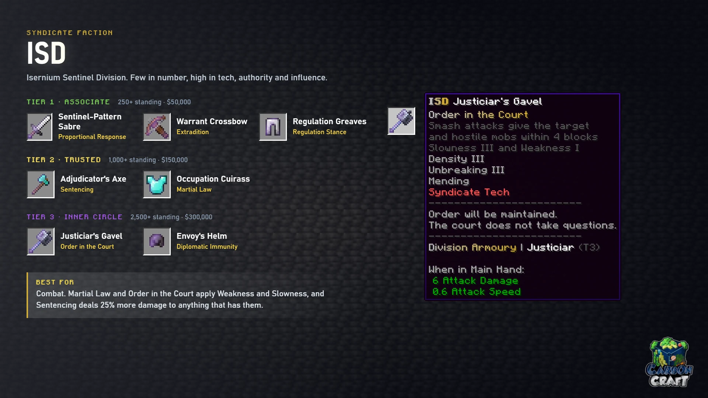

<!-- Sources (live): DeluxeMenus syndicate/isd/shop.yml (perk text), detail.yml;
     EcoItems items/ISD Set (base items); CarbonContribute shop-items.yml.
     Checked 2026-10-24. -->

# ISD

*Isernium Sentinel Division. Few in number, high in tech, authority and influence.*

**Best for:** combat. Martial Law and Order in the Court apply Weakness and Slowness,
and Sentencing deals 25% more damage to anything that has them.

| Tier | Item | Base | Perk | What it does |
|---|---|---|---|---|
| 1 | Sentinel-Pattern Sabre | Iron sword | Proportional Response | After a mob or player hits you, your next attack within 3 seconds deals 40% more damage |
| 1 | Warrant Crossbow | Crossbow | Extradition | Bolts pull the target toward you. 6 second cooldown |
| 1 | Regulation Greaves | Iron leggings | Regulation Stance | Immune to knockback |
| 2 | Adjudicator's Axe | Diamond axe | Sentencing | Deal 25% more damage to targets with Weakness or Slowness |
| 2 | Occupation Cuirass | Diamond chestplate | Martial Law | Hostile mobs within 6 blocks of you get Weakness I and Slowness I |
| 3 | Justiciar's Gavel | Mace | Order in the Court | Smash attacks give the target and hostile mobs within 4 blocks Slowness III and Weakness I for 3 seconds. 10 second cooldown |
| 3 | Envoy's Helm | Netherite helmet | Diplomatic Immunity | Immune to Poison, Wither, Slowness, Weakness and Mining Fatigue |

Tiers, prices and the 30-day limit work the same in every faction shop; see
[The Syndicate](index.md#3-spend-it-in-the-faction-shop).
