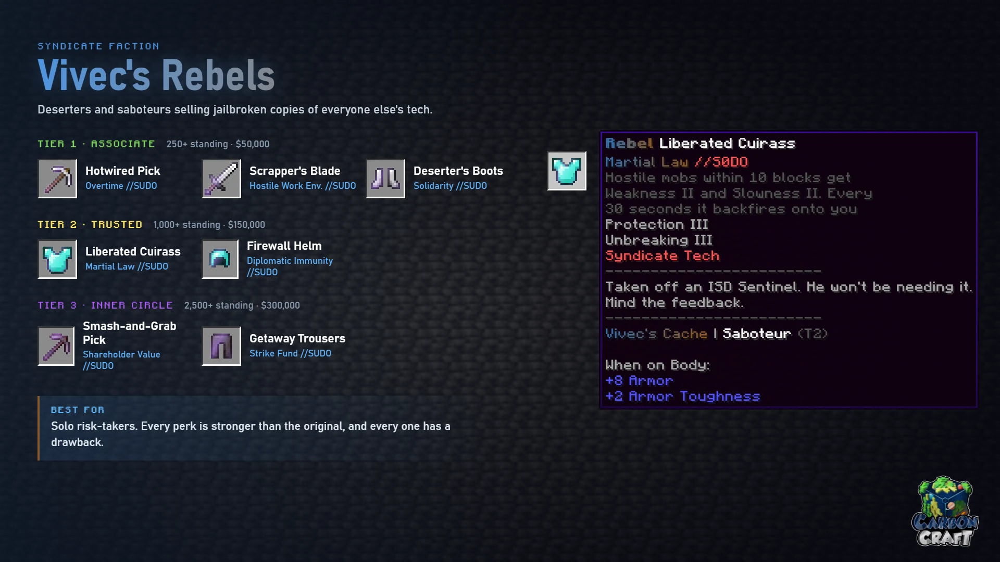

<!-- Sources (live): DeluxeMenus syndicate/rebels/shop.yml (perk text), detail.yml;
     EcoItems items/Rebels Set (base items); CarbonContribute shop-items.yml.
     Checked 2026-10-24. -->

# Vivec's Rebels

*Deserters and saboteurs devoted to driving the Company off-world, selling jailbroken
copies of everyone else's tech.*

**Best for:** solo risk-takers. Every perk is a stronger version of another faction's,
and every one has a drawback.

| Tier | Item | Base | Perk | What it does |
|---|---|---|---|---|
| 1 | Hotwired Pick | Iron pickaxe | Overtime //SUDO | Mining ore grants Haste III for 5 seconds. Each ore has a 5% chance to throttle you with Mining Fatigue II for 3 seconds |
| 1 | Scrapper's Blade | Iron sword | Hostile Work Environment //SUDO | Killing any mob grants Haste II and Strength I for 10 seconds, but also Hunger II |
| 1 | Deserter's Boots | Iron boots | Solidarity //SUDO | Take 25% less damage while no other player is within 16 blocks, but 15% more while one is |
| 2 | Liberated Cuirass | Diamond chestplate | Martial Law //SUDO | Hostile mobs within 10 blocks get Weakness II and Slowness II. Every 30 seconds it backfires onto you for 3 seconds |
| 2 | Firewall Helm | Diamond helmet | Diplomatic Immunity //SUDO | Immune to every potion effect, including the good ones |
| 3 | Smash-and-Grab Pick | Netherite pickaxe | Shareholder Value //SUDO | Ores have a 30% chance to drop triple, and a 15% chance to drop nothing |
| 3 | Getaway Trousers | Netherite leggings | Strike Fund //SUDO | Keep your hotbar and armour when you die. You respawn with Weakness II, Slowness II and Hunger for 60 seconds |

Tiers, prices and the 30-day limit work the same in every faction shop; see
[The Syndicate](index.md#3-spend-it-in-the-faction-shop).
