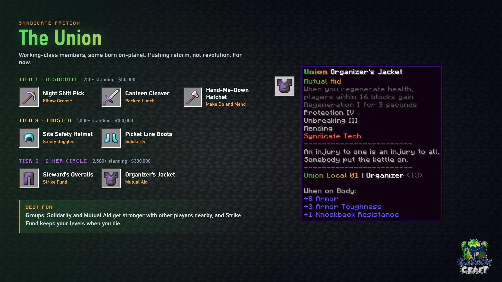

<!-- Sources (live): DeluxeMenus syndicate/union/shop.yml (perk text), detail.yml;
     EcoItems items/Union Set (base items); CarbonContribute shop-items.yml.
     Checked 2026-10-24. -->

# The Union

*Working-class members, some born on-planet. Pushing reform, not revolution. For now.*

**Best for:** groups. Solidarity and Mutual Aid get stronger with other players nearby,
and Strike Fund keeps your levels when you die.

| Tier | Item | Base | Perk | What it does |
|---|---|---|---|---|
| 1 | Night Shift Pick | Iron pickaxe | Elbow Grease | Gain Haste I at 6 hunger or less, and Haste II at 3 or less |
| 1 | Canteen Cleaver | Iron sword | Packed Lunch | Animals you kill drop their meat cooked |
| 1 | Hand-Me-Down Hatchet | Iron axe | Make Do and Mend | XP you collect repairs this item, 1 durability per XP, and you keep the XP |
| 2 | Site Safety Helmet | Diamond helmet | Safety Goggles | Immune to Blindness, Darkness, Nausea and Hunger |
| 2 | Picket Line Boots | Diamond boots | Solidarity | Take 10% less damage for each other player within 16 blocks, up to 30% |
| 3 | Steward's Overalls | Netherite leggings | Strike Fund | Keep your XP levels when you die |
| 3 | Organizer's Jacket | Netherite chestplate | Mutual Aid | When you regenerate health, other players within 16 blocks gain Regeneration I for 3 seconds. 5 second cooldown |

Tiers, prices and the 30-day limit work the same in every faction shop; see
[The Syndicate](index.md#3-spend-it-in-the-faction-shop).
